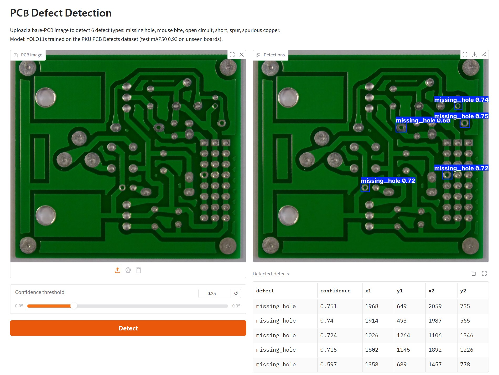
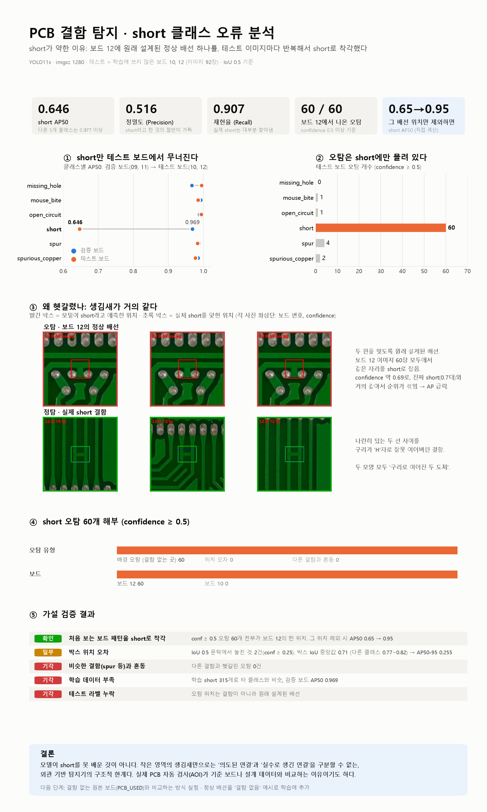

# PCB Defect Detection Demo

Upload a PCB image and get detected defects (missing hole, short, open circuit, spur, etc.) with bounding boxes.


*The Gradio demo (`app.py`) on a test-board image: 5 missing holes found. See [Run the demo locally](#run-the-demo-locally).*

## Results (YOLO11s, imgsz 1280, test on unseen boards 10 & 12)

| Class | mAP50 |
|---|---|
| missing_hole | 0.995 |
| mouse_bite | 0.985 |
| open_circuit | 0.994 |
| short | **0.646** |
| spur | 0.983 |
| spurious_copper | 0.977 |
| **all** | **0.930** (mAP50-95 0.481) |

Inference ≈ 12 ms / image on an RTX 4090. The `short` class is the weak spot (precision 0.52), which suggests many
false positives on boards not seen in training. See [Error analysis](#error-analysis-why-is-short-weak) for why.

## Error analysis: why is `short` weak?



**Finding:** almost all of the drop comes from one spot on test board 12. That board has a *designed* copper
bridge between two pads, and it looks just like a synthetic `short` (two conductors joined by copper).
The model flags it in every one of board 12's 60 test images.

| Check (test boards) | Result |
|---|---|
| `short` false positives at conf ≥ 0.5 | 60, **all** background hits at the same spot on board 12 |
| Confusion with other classes (spur, spurious copper) | 0 |
| Recall | 0.907, so real shorts are mostly found |
| `short` on validation boards 09, 11 | AP50 0.969, so the class itself is learned fine |
| AP50 with that spot treated as an ignore region | **0.65 → 0.95** |

Those false positives score about 0.69, close to true shorts (0.7x), so they mix into the ranking and pull AP down.
The ignore region also drops one real `short` label that happens to sit there.
AP is recomputed on the validator's own predictions, and the calculation reproduces Ultralytics' value (0.650 vs 0.646).

**Takeaway:** an appearance-only detector cannot tell an intended connection from an accidental one by looking at a
small patch. This is why industrial AOI compares against a golden board or the design data. Possible next steps
are comparing against the defect-free templates in `PCB_USED/`, or training with designed bridges as negatives.

Reproduce:
```bash
python src/analyze_errors.py      # -> analysis/report.json, analysis/short_top_fp.jpg, short_top_tp.jpg
python src/make_infographic.py    # -> analysis/short_error_analysis.png
```

## Reproduce
```bash
python -m venv .venv && .venv\Scripts\activate
pip install torch torchvision --index-url https://download.pytorch.org/whl/cu128
pip install -r requirements.txt
# prepare data: see data/README.md
python src/train.py          # trains, then evaluates on test boards -> results/pcb_yolo11s.json
```

## Run the demo locally
The trained weights are not in the repo (`*.pt` is gitignored), so train first (see [Reproduce](#reproduce)), then:
```bash
copy runs\detect\runs\pcb_yolo11s\weights\best.pt weights\best.pt   # macOS/Linux: cp
python app.py                # open http://127.0.0.1:7860
```
Or point the app at any checkpoint with `MODEL_PATH=path/to/best.pt`. On an RTX 4090 one image takes about 12 ms.

## Goals
- [x] Prepare a public PCB defect dataset (board-level split, no leakage)
- [x] Train a YOLO-based detector
- [x] Evaluate (mAP, per-class results)
- [x] Error analysis (why is `short` weak?)
- [x] Build a Gradio web demo (`python app.py`)
- [ ] Hosted online demo (skipped for now: Gradio apps on Hugging Face Spaces now need a paid plan)

## Tech Stack
Python · PyTorch · Ultralytics YOLO · Gradio

## Project Structure
```
pcb-defect-demo/
├── analysis/    # error analysis outputs (report.json, infographic, FP/TP crops)
├── data/        # dataset (not tracked by git, see data/README.md)
├── docs/        # README images
├── examples/    # sample images for the demo
├── results/     # test metrics (JSON)
├── src/         # data prep / training / evaluation / error analysis code
└── app.py       # Gradio web demo
```
